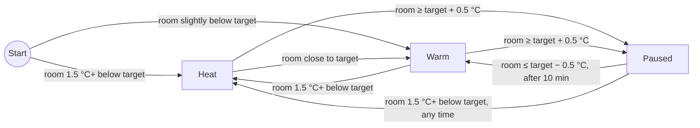

<div align="center">

# 🔥 MiHeaterBar

**Control your Xiaomi Wi-Fi heater from the macOS menu bar. It works locally, uses little energy, and needs no cloud.**

🇬🇧 English · [🇧🇷 Português (Brasil)](README.pt-BR.md)

[](#-requirements)
[](https://www.swift.org)
[](LICENSE)
[](#-privacy--files)
[](#-contributing)


&nbsp;

&nbsp;


</div>

---

## 📑 Contents

- [Features](#-features)
- [Supported devices](#-supported-devices)
- [Requirements](#-requirements)
- [Install](#-install)
- [Getting the device token](#-getting-the-device-token)
- [Configure](#%EF%B8%8F-configure)
- [How Smart Auto works](#-how-smart-auto-works)
- [Privacy & files](#-privacy--files)
- [Weekly report](#-weekly-report)
- [CLI probe](#%EF%B8%8F-cli-probe)
- [Development](#-development)
- [Set up with an AI assistant](#-set-up-with-an-ai-assistant)

## ✨ Features

| | |
|---|---|
| 🏠 **Local control** | Talks miIO (UDP 54321, AES-128-CBC) directly to the heater. You don't need a Xiaomi account while the app runs. |
| 🧩 **Spec-driven** | Reads the device's [MIoT spec](https://miot-spec.org) and enables only the features your model has: power, target, modes, oscillation and off-timer. |
| 🧠 **Smart Auto** | A hysteresis thermostat that uses the room sensor and picks the cheapest mode that still reaches the target. |
| 🛡️ **Fail-safe** | While Auto is on, the heater's own off-timer is renewed every 15 min. If the Mac sleeps or the app quits, the heater turns itself off within 60 min. |
| 📊 **Energy log** | A monthly CSV log, a 7-day kWh / € estimate in the menu, and a weekly Markdown report. |
| 🪶 **Lightweight** | SwiftUI with Liquid Glass and a Core Animation background. It measured about 0.01 % CPU with the panel open and 0 % when closed. |
| 🎮 **Never in the way** | Runs as a menu bar agent with no Dock icon. It never takes focus or plays sounds. |

## 📟 Supported devices

The app works with any heater whose MIoT spec has a `heater` service with an `on` property. Everything else is discovered per model.

| Model | Device | Status |
|---|---|---|
| `leshow.heater.nfj3lx` | Xiaomi Smart Tower Heater Lite | ✅ Tested on real hardware |
| `zhimi.heater.mc2a` | Mi Smart Space Heater S | 🧪 Tested against the emulator only |
| `zhimi.heater.ma5` | Smartmi heater family | 🧪 Tested against the emulator only |

> [!TIP]
> Some firmwares, including the `nfj3lx`, accept `set_properties` on `on` and then **ignore** it. When the spec exposes a `toggle` action, the app reads the current state first and calls the toggle action only if the state is different.
>
> If your model works, or doesn't, please [open an issue](../../issues) with its model string.

## 📋 Requirements

- 🍎 macOS 26 (Tahoe) or later
- 🛠️ Xcode 26 / Swift 6.2 toolchain
- 📶 The heater on the same LAN as the Mac. A DHCP reservation for its IP is recommended.
- 🔑 The device **token** (32 hex characters), see [below](#-getting-the-device-token)
- 🐍 *Optional:* Python 3 with `cryptography` for the end-to-end tests

## 🚀 Install

```bash
git clone https://github.com/Deehlusa/mi-heater-bar.git
cd mi-heater-bar
./build.sh --install          # builds, ad-hoc signs, copies to ~/Applications
open -g ~/Applications/MiHeaterBar.app
```

To use your own bundle identifier, run `BUNDLE_ID=com.yourname.miheaterbar ./build.sh --install`.

> [!IMPORTANT]
> On first launch, macOS asks for **Local Network** access. Allow it, or the app cannot reach the heater. You can change this later in *System Settings → Privacy & Security → Local Network*.

## 🔑 Getting the device token

miIO devices encrypt local traffic with a per-device token. Xiaomi doesn't show it in Mi Home. The usual way to get it is [Xiaomi Cloud Tokens Extractor](https://github.com/PiotrMachowski/Xiaomi-cloud-tokens-extractor):

1. Run the extractor and log in with your Xiaomi account.
2. Pick the server region where your device is registered, such as `de`, `cn` or `us`.
3. Find your heater in the list and copy its **IP** and **token**.

> [!WARNING]
> The token **changes every time the heater is reset or paired again**. If the app suddenly reports timeouts or invalid responses after a reset, get the token again.

## ⚙️ Configure

Click the menu bar icon and open **⚙ Settings**:

| Field | What to enter |
|---|---|
| **IP** | The heater's LAN address |
| **Token** | The 32-character hex token |
| **Auto → Target temperature** | The temperature Smart Auto holds (default 20 °C) |
| **Energy → Price** | Your electricity price in €/kWh, used only for estimates |

Then click **Save & Connect**.

## 🧠 How Smart Auto works

Every 30 s the app reads the room temperature and decides what to do:



| Room vs. target | Action |
|---|---|
| ≥ 1.5 °C below | 🔥 On, in the strong mode (`Heat`) |
| Slightly below | ♨️ On, in the gentle mode (`Warm`), which uses less power and avoids overshoot |
| ≥ target + 0.5 °C | ⏸️ Off (paused). The panel estimates when heating will resume. |
| Paused, back to target − 0.5 °C | ▶️ On again after at least 10 min paused, or right away if the room drops 1.5 °C below the target |

- Mode switching applies only to models that expose modes named `Heat` and `Warm`. On other models, Auto just switches the heater on and off.
- Any manual change to power, mode or target turns Auto off. Oscillation doesn't.

> [!NOTE]
> A resistive heater converts all its power into heat in every mode, so the savings come from heating less, not from a "more efficient" mode. On many models the built-in sensor sits inside the heater and reads in whole degrees, so expect it to read a little high.

## 🔒 Privacy & files

| What | Where |
|---|---|
| 🔑 Device token | `~/Library/Application Support/MiHeaterBar/token` (file mode `0600`) |
| 📦 Cached MIoT specs | `~/Library/Application Support/MiHeaterBar/spec-<model>.json` |
| 📈 Usage log (CSV) | `~/Library/Application Support/MiHeaterBar/log-YYYY-MM.csv` |
| ⚙️ IP, Auto target, price | `defaults read <bundle id>` |

- 🚫 **No telemetry or analytics.** The only internet request is a one-time HTTPS download of your model's spec from `miot-spec.org`. After that, the app uses the local cache.
- 🗝️ The token is kept in a user-only file rather than the Keychain, because the Keychain asks for your password again after every rebuild of an ad-hoc signed app. The token only grants control of the heater on your LAN, but you should still treat it as a secret.
- 🌐 The miIO protocol's encryption is weak, since the key is derived from the token with MD5. Keep IoT devices on a trusted or isolated network.

## 📊 Weekly report

```bash
python3 -I report.py                          # last 7 days, default price
python3 -I report.py --price 0.20 --days 30 --out
```

The report covers hours on, estimated kWh and cost, Auto cycles, night-time use and suggestions. Energy figures are estimates based on the logged mode, because the heater doesn't measure its own power draw.

## 🖥️ CLI probe

Run the binary outside the `.app` bundle and it works as a probe tool:

```bash
swift build
.build/debug/MiHeaterBar <ip> <token> [--power on|off] [--target N] [--mode N] [--osc on|off] [--countdown N]
```

It applies the given settings, then prints the device's capabilities and state as JSON.

## 🧪 Development

```bash
swift test        # unit tests: protocol codec, spec parsing, Smart Auto, energy
./e2e.sh          # builds and drives the probe against fake_heater.py (3 emulated models)
```

`fake_heater.py` emulates a miIO heater on `127.0.0.1:54321`, including the firmware quirk that ignores `set_properties` on `on`.

```text
Sources/
├── HeaterKit/      # protocol (MiIO), spec discovery (MiotSpec), device API (Heater), SmartAuto, EnergyEstimate
└── MiHeaterBar/    # menu bar app (SwiftUI), controller, settings, event log
Tests/
└── HeaterKitTests/ # unit tests + MIoT spec fixtures
```

### 🤝 Contributing

Issues and PRs are welcome, especially reports from new heater models, localization and fixes for firmware quirks. Please run `swift test` and `./e2e.sh` before you open a PR.

## 🤖 Set up with an AI assistant

Paste this prompt into any LLM (ChatGPT, Claude, Gemini, a local model…) to get a step-by-step setup guide:

```text
You are a patient macOS setup assistant. Help me install and configure MiHeaterBar,
an open-source macOS menu bar app that controls Xiaomi/Mijia Wi-Fi heaters over the
local network (miIO protocol). Repository: https://github.com/Deehlusa/mi-heater-bar

Guide me ONE step at a time and wait for my confirmation or output before continuing.
Ask first: my macOS version, whether Xcode 26 is installed, and my heater model.

Steps to cover:
1. Check requirements: macOS 26+, Xcode 26 / Swift 6.2 (`swift --version`),
   heater and Mac on the same Wi-Fi network.
2. Clone the repo and run `./build.sh --install`, then
   `open -g ~/Applications/MiHeaterBar.app`. Allow "Local Network" access when asked.
3. Get the heater IP and 32-hex-character token with Xiaomi Cloud Tokens Extractor
   (https://github.com/PiotrMachowski/Xiaomi-cloud-tokens-extractor): log in, pick the
   server region where the device is registered, copy IP + token.
4. Recommend a DHCP reservation for the heater IP in my router (explain generically;
   do not tell me to change anything else in the router).
5. In the app: Settings -> IP, Token, Auto target temperature, price per kWh ->
   "Save & Connect".
6. Verify with the CLI probe if something fails:
   `swift build && .build/debug/MiHeaterBar <ip> <token>` should print JSON.

Troubleshooting you should know:
- Timeout: wrong IP, different network/VLAN, Local Network permission denied
  (System Settings -> Privacy & Security -> Local Network), or the heater is offline.
- "Invalid response" right after a reset or re-pair: the token changed; extract it again.
- Device error -4004 or commands that are acknowledged but have no effect:
  firmware quirk; report the model string in a GitHub issue.
- Model not supported: the device has no MIoT "heater" service.

Security rules: never ask me to paste my token, Xiaomi password or Wi-Fi password into
this chat. Tell me where to paste them (the extractor, the app) instead.
Safety: remind me not to leave the heater running unattended or overnight.
Answer in my language.
```

## ⚖️ Disclaimer

This project is not affiliated with, endorsed by or sponsored by Xiaomi. "Xiaomi", "Mi" and "Mijia" are trademarks of their respective owners.

## 📄 License

[MIT](LICENSE) © Deehlusa
