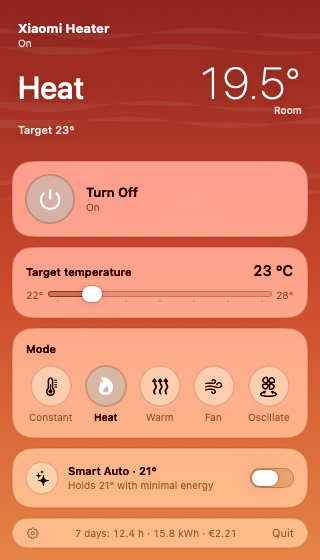
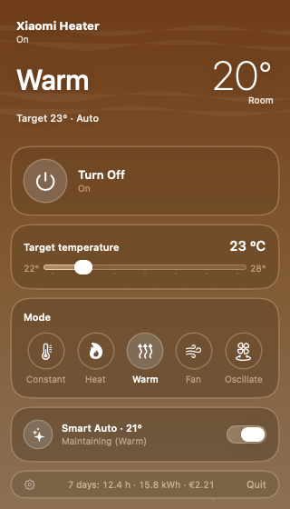
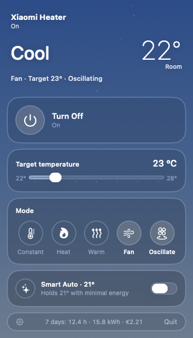
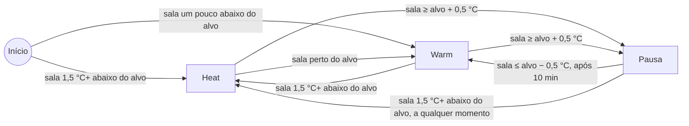

<div align="center">

# 🔥 MiHeaterBar

**Controle seu aquecedor Xiaomi Wi-Fi pela barra de menus do macOS. Funciona na rede local, consome pouca energia e dispensa a nuvem.**

[🇬🇧 English](README.md) · 🇧🇷 Português (Brasil)

[](#-requisitos)
[](https://www.swift.org)
[](LICENSE)
[](#-privacidade-e-arquivos)
[](#-como-contribuir)


&nbsp;

&nbsp;


</div>

---

## 📑 Sumário

- [Recursos](#-recursos)
- [Aparelhos compatíveis](#-aparelhos-compatíveis)
- [Requisitos](#-requisitos)
- [Instalação](#-instalação)
- [Como obter o token do aparelho](#-como-obter-o-token-do-aparelho)
- [Configuração](#%EF%B8%8F-configuração)
- [Como funciona o Smart Auto](#-como-funciona-o-smart-auto)
- [Privacidade e arquivos](#-privacidade-e-arquivos)
- [Relatório semanal](#-relatório-semanal)
- [Probe pela linha de comando](#%EF%B8%8F-probe-pela-linha-de-comando)
- [Desenvolvimento](#-desenvolvimento)
- [Configuração com um assistente de IA](#-configuração-com-um-assistente-de-ia)

## ✨ Recursos

| | |
|---|---|
| 🏠 **Controle local** | Fala miIO (UDP 54321, AES-128-CBC) direto com o aquecedor. Você não precisa de conta Xiaomi enquanto o app roda. |
| 🧩 **Guiado pela spec** | Lê a [spec MIoT](https://miot-spec.org) do aparelho e ativa só os recursos que o seu modelo tem: liga/desliga, temperatura alvo, modos, oscilação e timer de desligamento. |
| 🧠 **Smart Auto** | Um termostato com histerese que usa o sensor do ambiente e escolhe o modo mais econômico que ainda alcança o alvo. |
| 🛡️ **Fail-safe** | Com o Auto ligado, o timer de desligamento do próprio aquecedor é renovado a cada 15 min. Se o Mac dormir ou o app fechar, o aquecedor se desliga sozinho em até 60 min. |
| 📊 **Registro de energia** | Log mensal em CSV, estimativa de kWh / € dos últimos 7 dias no menu e um relatório semanal em Markdown. |
| 🪶 **Leve** | SwiftUI com Liquid Glass e fundo em Core Animation. Medimos cerca de 0,01 % de CPU com o painel aberto e 0 % com ele fechado. |
| 🎮 **Não atrapalha** | Roda como agente da barra de menus, sem ícone no Dock. Nunca rouba o foco nem toca sons. |

## 📟 Aparelhos compatíveis

O app funciona com qualquer aquecedor cuja spec MIoT tenha um serviço `heater` com a propriedade `on`. O resto é descoberto modelo a modelo.

| Modelo | Aparelho | Status |
|---|---|---|
| `leshow.heater.nfj3lx` | Xiaomi Smart Tower Heater Lite | ✅ Testado no aparelho real |
| `zhimi.heater.mc2a` | Mi Smart Space Heater S | 🧪 Testado só no emulador |
| `zhimi.heater.ma5` | Família de aquecedores Smartmi | 🧪 Testado só no emulador |

> [!TIP]
> Alguns firmwares, como o do `nfj3lx`, aceitam `set_properties` em `on` e depois **ignoram** o comando. Quando a spec expõe uma ação `toggle`, o app lê o estado atual antes e só chama a ação se o estado for diferente.
>
> Se o seu modelo funcionar, ou não, [abra uma issue](../../issues) com o nome do modelo.

## 📋 Requisitos

- 🍎 macOS 26 (Tahoe) ou mais recente
- 🛠️ Xcode 26 / toolchain Swift 6.2
- 📶 Aquecedor na mesma rede local que o Mac. Recomendamos reservar o IP dele no DHCP do roteador.
- 🔑 O **token** do aparelho (32 caracteres hex), veja [abaixo](#-como-obter-o-token-do-aparelho)
- 🐍 *Opcional:* Python 3 com `cryptography` para os testes de ponta a ponta

## 🚀 Instalação

```bash
git clone https://github.com/Deehlusa/mi-heater-bar.git
cd mi-heater-bar
./build.sh --install          # compila, assina ad-hoc e copia para ~/Applications
open -g ~/Applications/MiHeaterBar.app
```

Para usar o seu próprio bundle identifier, rode `BUNDLE_ID=com.seunome.miheaterbar ./build.sh --install`.

> [!IMPORTANT]
> Na primeira vez que o app abrir, o macOS pede acesso à **Rede Local**. Permita, ou o app não consegue falar com o aquecedor. Dá para mudar isso depois em *Ajustes do Sistema → Privacidade e Segurança → Rede Local*.

## 🔑 Como obter o token do aparelho

Os aparelhos miIO criptografam o tráfego local com um token próprio de cada aparelho. A Xiaomi não mostra esse token no Mi Home. O jeito mais comum de obtê-lo é o [Xiaomi Cloud Tokens Extractor](https://github.com/PiotrMachowski/Xiaomi-cloud-tokens-extractor):

1. Rode o extrator e entre com a sua conta Xiaomi.
2. Escolha a região do servidor onde o aparelho está cadastrado, como `de`, `cn` ou `us`.
3. Encontre o aquecedor na lista e copie o **IP** e o **token**.

> [!WARNING]
> O token **muda toda vez que o aquecedor é resetado ou pareado de novo**. Se o app começar a dar timeout ou resposta inválida depois de um reset, extraia o token outra vez.

## ⚙️ Configuração

Clique no ícone da barra de menus e abra **⚙ Settings**:

| Campo | O que preencher |
|---|---|
| **IP** | O endereço do aquecedor na rede local |
| **Token** | O token de 32 caracteres hex |
| **Auto → Target temperature** | A temperatura que o Smart Auto mantém (padrão 20 °C) |
| **Energy → Price** | O preço da sua energia em €/kWh, usado só nas estimativas |

Depois clique em **Save & Connect**.

## 🧠 Como funciona o Smart Auto

A cada 30 s o app lê a temperatura do ambiente e decide o que fazer:



| Sala em relação ao alvo | Ação |
|---|---|
| 1,5 °C ou mais abaixo | 🔥 Liga no modo forte (`Heat`) |
| Um pouco abaixo | ♨️ Liga no modo suave (`Warm`), que gasta menos e evita passar do alvo |
| Alvo + 0,5 °C ou mais | ⏸️ Desliga (pausa). O painel estima quando o aquecimento volta. |
| Em pausa, de volta a alvo − 0,5 °C | ▶️ Religa depois de pelo menos 10 min em pausa, ou na hora se a sala cair 1,5 °C abaixo do alvo |

- A troca de modo só vale para modelos que têm modos chamados `Heat` e `Warm`. Nos outros, o Auto apenas liga e desliga o aquecedor.
- Qualquer mudança manual em liga/desliga, modo ou alvo desativa o Auto. A oscilação, não.

> [!NOTE]
> Um aquecedor resistivo transforma toda a potência em calor em qualquer modo. A economia vem de aquecer menos, não de um modo "mais eficiente". Em muitos modelos o sensor fica dentro do próprio aquecedor e mede em graus inteiros, então ele tende a marcar um pouco acima da temperatura real da sala.

## 🔒 Privacidade e arquivos

| O quê | Onde |
|---|---|
| 🔑 Token do aparelho | `~/Library/Application Support/MiHeaterBar/token` (permissão `0600`) |
| 📦 Specs MIoT em cache | `~/Library/Application Support/MiHeaterBar/spec-<modelo>.json` |
| 📈 Log de uso (CSV) | `~/Library/Application Support/MiHeaterBar/log-AAAA-MM.csv` |
| ⚙️ IP, alvo do Auto, preço | `defaults read <bundle id>` |

- 🚫 **Sem telemetria nem analytics.** A única conexão com a internet é um download HTTPS único da spec do seu modelo em `miot-spec.org`. Depois disso, o app usa o cache local.
- 🗝️ O token fica num arquivo que só o seu usuário lê, e não no Keychain, porque o Keychain pede a senha de novo a cada recompilação de um app assinado ad-hoc. O token só dá controle do aquecedor na sua rede local, mas trate-o como segredo mesmo assim.
- 🌐 A criptografia do protocolo miIO é fraca, porque a chave é derivada do token com MD5. Mantenha aparelhos IoT numa rede confiável ou isolada.

## 📊 Relatório semanal

```bash
python3 -I report.py                          # últimos 7 dias, preço padrão
python3 -I report.py --price 0.20 --days 30 --out
```

O relatório mostra horas ligado, kWh e custo estimados, ciclos do Auto, uso de madrugada e sugestões. Os números de energia são estimativas feitas a partir do modo registrado, porque o aquecedor não mede o próprio consumo. O relatório sai em inglês.

## 🖥️ Probe pela linha de comando

Rodado fora do bundle `.app`, o binário funciona como ferramenta de diagnóstico:

```bash
swift build
.build/debug/MiHeaterBar <ip> <token> [--power on|off] [--target N] [--mode N] [--osc on|off] [--countdown N]
```

Ele aplica os ajustes pedidos e depois imprime em JSON as capacidades e o estado do aparelho.

## 🧪 Desenvolvimento

```bash
swift test        # testes unitários: codec do protocolo, leitura da spec, Smart Auto, energia
./e2e.sh          # compila e testa o probe contra o fake_heater.py (3 modelos emulados)
```

O `fake_heater.py` emula um aquecedor miIO em `127.0.0.1:54321`, inclusive o defeito de firmware que ignora `set_properties` em `on`.

```text
Sources/
├── HeaterKit/      # protocolo (MiIO), descoberta da spec (MiotSpec), API do aparelho (Heater), SmartAuto, EnergyEstimate
└── MiHeaterBar/    # app da barra de menus (SwiftUI), controller, ajustes, log de eventos
Tests/
└── HeaterKitTests/ # testes unitários + specs MIoT de exemplo
```

### 🤝 Como contribuir

Issues e PRs são bem-vindos, principalmente relatos de novos modelos de aquecedor, traduções e correções para defeitos de firmware. Rode `swift test` e `./e2e.sh` antes de abrir um PR.

## 🤖 Configuração com um assistente de IA

Cole este prompt em qualquer LLM (ChatGPT, Claude, Gemini, um modelo local…) para receber um guia de instalação passo a passo:

```text
Você é um assistente paciente de configuração de macOS. Me ajude a instalar e configurar
o MiHeaterBar, um app open source para a barra de menus do macOS que controla
aquecedores Xiaomi/Mijia Wi-Fi pela rede local (protocolo miIO).
Repositório: https://github.com/Deehlusa/mi-heater-bar

Me guie UM passo por vez e espere minha confirmação ou o resultado antes de continuar.
Pergunte primeiro: minha versão do macOS, se tenho o Xcode 26 instalado e o modelo do
meu aquecedor.

Passos a cobrir:
1. Conferir os requisitos: macOS 26+, Xcode 26 / Swift 6.2 (`swift --version`),
   aquecedor e Mac na mesma rede Wi-Fi.
2. Clonar o repositório e rodar `./build.sh --install`, depois
   `open -g ~/Applications/MiHeaterBar.app`. Permitir o acesso à "Rede Local" quando pedido.
3. Obter o IP e o token de 32 caracteres hex do aquecedor com o Xiaomi Cloud Tokens
   Extractor (https://github.com/PiotrMachowski/Xiaomi-cloud-tokens-extractor): entrar,
   escolher a região do servidor onde o aparelho está cadastrado, copiar IP + token.
4. Recomendar reservar o IP do aquecedor no DHCP do roteador (explique de forma genérica;
   não me peça para mudar mais nada no roteador).
5. No app: Settings -> IP, Token, Auto target temperature, preço por kWh ->
   "Save & Connect".
6. Se algo falhar, verificar com o probe pela linha de comando:
   `swift build && .build/debug/MiHeaterBar <ip> <token>` deve imprimir um JSON.

Problemas comuns que você deve conhecer:
- Timeout: IP errado, rede/VLAN diferente, permissão de Rede Local negada
  (Ajustes do Sistema -> Privacidade e Segurança -> Rede Local) ou aquecedor offline.
- "Invalid response" logo depois de um reset ou novo pareamento: o token mudou;
  extraia de novo.
- Erro do aparelho -4004, ou comandos aceitos que não fazem efeito: defeito do firmware;
  informe o nome do modelo numa issue do GitHub.
- Modelo não suportado: o aparelho não tem o serviço MIoT "heater".

Regras de segurança: nunca me peça para colar meu token, minha senha Xiaomi ou a senha
do Wi-Fi neste chat. Diga onde colá-los (no extrator, no app).
Segurança física: me lembre de não deixar o aquecedor ligado sem supervisão ou durante a noite.
Responda em português do Brasil.
```

## ⚖️ Aviso legal

Este projeto não tem vínculo com a Xiaomi e não é endossado nem patrocinado por ela. "Xiaomi", "Mi" e "Mijia" são marcas registradas dos respectivos donos.

## 📄 Licença

[MIT](LICENSE) © Deehlusa
